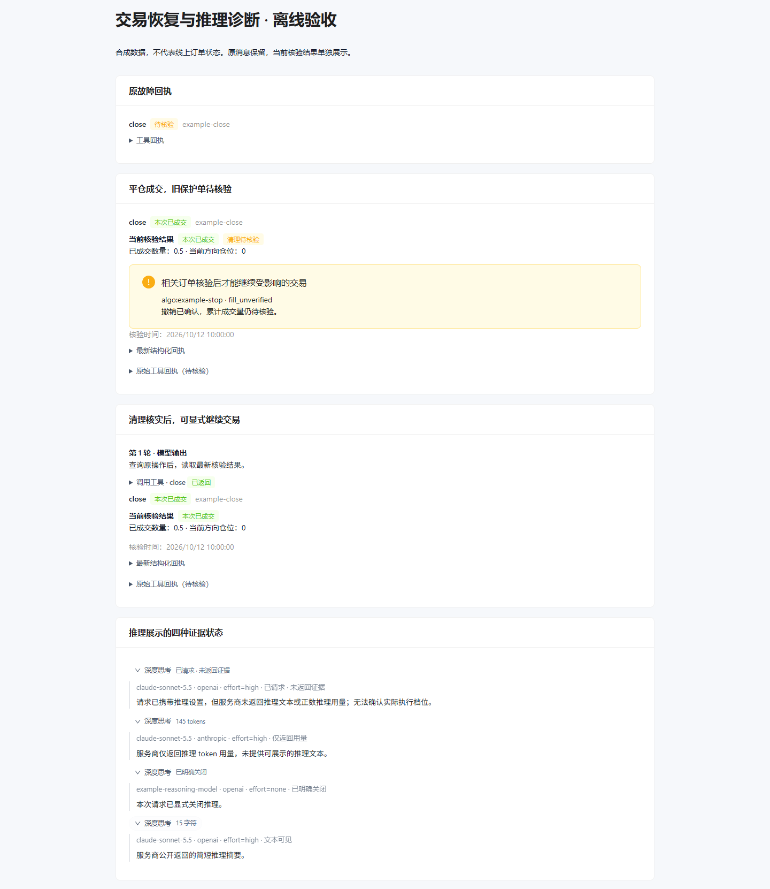
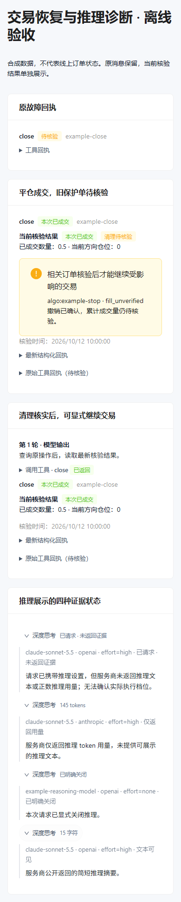

# 实施验收记录

日期：2026-10-12。变更：`fix-independent-trade-recovery`。
所有交易测试使用离线 fake exchange / mock 账本 / 临时 SQLite；没有操作实盘订单。
模型协议使用合成 HTTP/SSE 响应，没有执行在线付费探测，也没有保存用户密钥或真实签名。

## 交付行为

市价平仓的已确认成交与旧保护单清理分别报告。原 close 已核实成交时，清理失败不能再
把它覆盖为 unknown；清理单身份、累计成交待核验、重试时间和受影响动作独立可见。
真正提交未知仍保留 unknown。可靠事实不足时，新交易在写入前重新核验并拒绝。

`get_trade_operation`、同 ID 重放、REAL 后台和 MCP `get_operation` 共用原操作证据。
查询不 create/edit/cancel，也不恢复归属或重放批次尾部。首次回执、请求哈希及旧周期保留。
缺失周期只有完整归属和成交证据才可由授权写入口修复原 episode_id。

推理诊断显示最终协议、实际模型、请求 effort、实际发送参数及返回证据。
空文本不会再静默隐藏已请求状态；正数用量与可见文本分别展示。发送了 effort 不等于
证实网关严格执行该档位。原生 thinking/signature 和工具续接保留。

## 验收矩阵

| 场景 | 可复核证据 | 结果 |
| --- | --- | --- |
| 市价平空成功、旧止损撤销 ACK 缺累计成交 | `tests/test_trade_tool_integration.py` 主故障回归 | completed + cleanup.pending，市价单只提交一次 |
| close → 查询 → 后台清理 → Agent 显式新入场 | `test_close_cleanup_recovery_then_explicit_new_entry_once` | 查询不写交易所，原成交持续可见，新入场只执行一次，跨周期仍可查旧操作 |
| 提交前拒绝 / 超时 / 提交后落库失败 | `tests/test_trade_tool_integration.py` | 分别保存 not_submitted / unknown 身份 / 已知成交，不重复 callback |
| 真实未知与读接口持续失败 | `test_persistent_unknown_blocks_dependent_writes_after_read_query` | 原 ID 可查，保留 blocker，依赖写入被拒绝 |
| 撤单缺字段、倒退成交、旧 open、母子 ID 同号 | `test_independent_exits.py`、`test_independent_real_v2.py`、`test_independent_binance_v2.py`、`test_independent_cancel_budget.py` | 不把缺字段合成为最终零成交；补查最多 3 次/2 秒，母子共用预算，后台退避 |
| 一次空仓、晚到入场残仓与重启 | `test_independent_exits.py`、`test_late_verified_residual_can_be_explicitly_managed` | 一次空仓不结束周期；允许已核实残仓显式保护/减仓，不自动补平 |
| 旧 all 阻塞、Hedge / One-way 准入 | `test_admission_isolates_hedge_but_blocks_one_way_shared_unknown` 及 real_v2 | 同向未核实阻止开仓；One-way 不按 Hedge 隔离放行 |
| native edit 拒绝/超时、cancel_replace 替代失败 | `test_independent_receipt_recovery.py`、`test_independent_real_v2.py` | 原订单保留；旧单取消不冒充替代成功；重启无重复 edit/create |
| 缺失周期恢复、历史缺项/归属/数量/后继周期冲突 | `test_independent_receipt_recovery.py`、`test_independent_exits.py` | 只读只诊断；完整证据恢复原周期，其他情况拒绝；可靠空仓 skipped |
| MCP principal/profile 隔离、同 ID 恢复 | `tests/test_mcp_trade_recovery.py` 及 MCP 原测试 | read 零金融写入；外部操作 ID 与内部稳定 ID 关联并保存修订 |
| 批次尾部、legacy aliases、Agent/Chat 多工具 | `test_trade_batch.py`、`test_trade_tool_integration.py`、`test_decision_memory_context.py` | 交易失败后仍能只读查询；审批保留，未执行尾部不补发 |
| 现货、附带保护、mock 与旧 all 数量解释 | 全量 Python 套件及保留的旧 receipt_recovery 用例 | 共用状态解析兼容，旧请求哈希不变 |
| effort 实际参数与 extra_body 覆盖 | `tests/test_reasoning_diagnostics.py` | 捕获最终请求，不记录 key/header/prompt；明确拒绝不支持的关闭配置 |
| chat 空白/零用量、native 空 thinking 与 SSE 最终用量 | `tests/test_reasoning_diagnostics.py` | 合成三组响应形状；文本与用量分离，无缺文本自动补调 |
| signature/tool_result 续接、fallback 实际模型 | `test_reasoning_diagnostics.py`、`test_decision_retry_refresh.py` | 合成签名原样续接，模型回退有诊断，流式用量只计一次 |
| Agent/Chat 事件、历史、SQLite 重启 | `tests/test_reasoning_persistence.py` | 推理诊断和用量可持久化恢复 |
| 可选在线探测限额 | `tests/test_reasoning_probe.py` | 最多 6 请求、2048 输出 tokens/次、45 秒/次、无自动补测、无凭据落盘 |

## 数据库升级、并发及回滚演练

`test_real_old_database_upgrade_preserves_raw_first_receipt_and_hash` 从临时旧库升级两次，
检查原 unknown 回执字节、旧请求哈希及历史周期不变；随后完整备份，按旧表只读访问，
再升级备份副本，原证据/修订全部保留。`test_evidence_migration_and_original_receipt_are_idempotent`
确认旧/新两个周期独立存在，拒绝版本和累计成交倒退。

`tests/test_trade_evidence_concurrency.py` 用 Windows spawn 两个独立进程同时更新同一版本，
仅一个提交成功，另一个遇到版本冲突；重开数据库和重复迁移后证据仍完整。
账户变更测试确认旧凭据所属证据不会被用于新账户。

回滚操作顺序：暂停自动交易/维护 → 完整备份 → 保留所有新增表与审计 → 旧版仅在能解释
当前周期时恢复，否则保持只读 → 兼容版本重新升级。未演练允许旧版写入新格式在途订单；
无需清空生产周期或向交易所重发任何订单。

## 命令与结果

- 分组回归：97 项交易/回执/原有独立退出测试通过；39 项恢复/退避/迁移边界测试通过；59 项 Binance 适配器/real_v2 测试通过（分组有重叠）。最终差异检查补充了终态母单收到旧 NEW 且缺成交字段的反例：先复现失败，再修复，终态及待核验成交均保留。
- `uv run pytest tests -q --tb=short`：最终 **1489 passed, 26 subtests passed**，180.46 秒。包括最后补充的终态母单旧响应反例。
- `npm run build --prefix frontend`：通过。Vite 提示部分分包超过 500 kB，构建无错误。
- `npm run test:chat --prefix frontend`：24/24 通过。
- `npm run test:dashboard --prefix frontend`：13/13 通过。
- `uv run --with playwright python tests/browser_trade_recovery.py`：桌面 1440 px、移动 390 px 均通过，无页面脚本错误、无水平溢出。
- `git diff --check` 与 `openspec validate fix-independent-trade-recovery --strict`：通过。新增内容凭据检查未发现真实格式的长 API key 字面量。

浏览器使用真实前端组件和合成数据。前后对照包括原 unknown、已成交但待清理、清理核实后，
以及推理文本可见、仅用量、已请求未返回证据、显式关闭四种展示。
工具调用标题和回执卡片都读取当前核验状态；展开原始回执仍可查看历史 unknown。

## 现场证据边界

用户截图的 tool-call ID `toolu_01E2Cf7N8WJBBcVb87TGdTeC` 未在可用本地记录中匹配到，
本地最新运行记录停留在 2026-09-07。缺少对应任务、准确时间窗、真实订单 ACK 和周期事件，
因此无法认定截图那笔空单是否已平，也不能把本地代码中的故障机制认定为现场唯一根因。
本次交付为本地实施与离线验收；未部署、未修改实盘仓位、未声称线上个案已核验。
